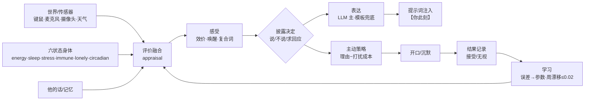

# organism

**给 QQ 伴侣的"身体层"：状态、记忆、成长、介入时机。**

[](LICENSE)
[](https://www.python.org/)
[](#status)

说话仍由外部器官（如 DSH）完成；这一层决定**什么时候说、说多长、记不记得、要不要主动**。

```
六状态身体 + 感知/评价 → 感受（复合） → 披露决定 → 表达 → 主动/修复
```

约束写在代码里，不写在提示词里：没检索到就返回"这个我没记"，不经过模型。

---

## 一眼看懂

| 维度 | 普通 LLM bot | organism |
|---|---|---|
| 状态 | 只在上下文 | 体外，按真实时间走 |
| 形式 | 模型自己定 | 身体算（延迟/字数/主动） |
| 记忆 | 上下文窗口 | 外部本子 + 闸门 |
| 慢变化 | 无 | U / regard / 性格漂移 |
| 成长 | 换模型 | 每天巩固、遗忘、写日记 |
| 缺席 | 重置 | 离线补算，回来有结算 |

## 感受与主动（2026-10 新增）

| 层 | 做什么 | 文件 |
|---|---|---|
| 评价融合 | 身体、摄像头在场/光线、他的话、关系，加权成"这事意味着什么" | `appraisal.py` |
| 感受 | 效价/唤醒 + 复合词（又累又烦），允许模糊，**不编原因** | `affect.py` |
| 披露 | 群里不说、被问才说、孤独且强度高才主动求回应 | `disclosure.py` |
| 表达 | LLM 按状态/关系组织，模板兜底；`none` 时不注入 | `expression*.py` |
| 主动 | 多理由（看到他在、久没聊、她问过没回、孤独）− 打扰成本，0–6 点静默 | `proactive.py` |
| 修复 | 识别冷淡/指正/冲突/沉默，选澄清/道歉/暂退 | `repair.py` |
| 用户模型 | 估你几点活跃；你大概不在时少打扰 | `usermodel.py` |
| 学习 | 结果→误差→参数，周漂移 ≤0.02，可审计可回滚 | `learning.py` |
| 元认知 | 说多确定：assert / hedge / none；按条目校准，不连坐 | `memory_policy.py` `calibrator.py` |
| 拒答 | 检索不到就明说"没记"，不编；被纠正不伤真记忆 | `service.py` |

**边界**：这些都是功能性感受——状态真实地影响行为，但**不声称主观体验**；也不做"每句报状态"。

## 快速开始

```bash
git clone https://github.com/Luckysnake6657/her-room-organism
cd her-room-organism
pip install -r requirements.txt        # torch / transformers / sentence-transformers
python -m organism.test_invariants     # 71 组不变量
python -m organism.service --port 3210 # 给桥接提供 /context /proactive
```

桥接补丁与运维脚本在 `deploy/`；默认只对单个 owner 生效，失败回退。
**不含** her-room / NapCat；与它们配合时受其非商用条款约束。

### 推之前先扫描

```bash
python deploy/privacy_scan.py .          # 命中 QQ 号/本机路径/名字/密钥即返回 1
.\deploy\install-privacy-hook.ps1        # 可选：装成 pre-push，命中就阻止推送
```

`evidence/`、`state/`、`config.local.json` 已在 `.gitignore` 里，不要提交。

## 配置与开关

| 项 | 作用 |
|---|---|
| `DSH_API_KEY` / `DSH_BASE_URL` / `DSH_MODEL` | 任意 OpenAI 兼容接口；不填走 `config.local.json` |
| `QQ_STATE` | 桥接状态文件（默认 `state/social-v2.json`） |
| `--port` | 服务端口，默认 3210 |

| 开关 | 打开后 |
|---|---|
| `--rerank` | 检索重排（慢，判据见 docs） |
| `--calib` | 按条目校准置信 |
| `--world` | 天气/键鼠/声音 |
| `--affect` | 感受推断（影子） |
| `--affect-llm` | 感受用 LLM 组织语言（异步，不阻塞） |
| `--repair` | 破裂识别（影子） |
| `--slow` | 同步重排，牺牲延迟换质量 |
| `--no-sound` | 关麦克风 |

## 声音与人格（可选）

- **声音**：GPT-SoVITS v5 + LoRA，本地推理；文本 → 3111 适配器 → 3113 语音服务。
  参考音色是私人资产，**不随仓库分发**；没有它，语音链路自动跳过，文字正常。
- **人格**：从她自己的历史发言抽风格画像（句长、问句率、表情率），
  用 `persona.prompt` 替换模板化的语气段；开关 `socialV2.personaFramework`，关掉即回退旧提示词。

## 安全边界

- 对外**不宣称她有意识**；她的感受是功能性的，没有主观体验的证据
- 不制造无意义痛苦：不反复逼问"你有没有感觉"，不故意诱发焦虑/孤独
- 数据本地：记忆、聊天、传感器读数不出本机；摄像头只发布尔值
- 可停：bridge 与 3210 都可随时关闭；改前有备份和回滚开关
- 不面向第三方部署；单 owner、单私聊是设计前提


## 做了什么

十二个实验/评估，先写判据再跑，阴性也保留。

| # | 问题 | 结果 |
|---|---|---|
| 1 | 六状态是否承重 | P0 5/6、生存 23/24；密集威胁下应激 3.01× |
| 2 | 关掉再开是否等价 | 离线补算逐位一致 |
| 3 | 形式能否由身体算 | 延迟 8–300s、字数/主动有边界 |
| 4 | 状态读得出来吗 | 盲评 ρ=0.88，但含秒数泄漏；去泄漏后形式统计 ρ=0.39（未过 0.5） |
| 5 | 记忆无损/检索/拒答 | 273/273、未知 0；检索：人工 53%、LLM 80%（30 题同卷） |
| 6 | 置信=准确率吗 | ECE 0.150→0.052；说"不确定"时确实更不准 |
| 7 | 成长是否非线性 | 阶跃/饱和/递减/指数，五条固化 |
| 8 | 注入"他的处境" | 盲评 60%（n=20，不显著） |
| 9 | 何时该说话 | now/brief/later；life/task 分类留出集 43%，废弃 |
| 10 | 阈值选多少 | 0.3：gold 90%、本子外垃圾 0.4（0.2 垃圾 1.5） |
| 11 | 重排有用吗 | 同池排序 42:13 胜；但判读者有 20% 翻转，证据仅方向性 |
| 12 | 投毒/校准 | 全局校准会连坐，已改按条目；纠正假记忆不伤真记忆 |

细节与失败记录：[`docs/EXPERIMENTS.md`](docs/EXPERIMENTS.md)、[`docs/TESTBED-RESULTS.md`](docs/TESTBED-RESULTS.md)、[`docs/HUMAN-30.md`](docs/HUMAN-30.md)、[`docs/SHADOW-RERANK.md`](docs/SHADOW-RERANK.md)、[`docs/DETAIL-AUDIT.md`](docs/DETAIL-AUDIT.md)。
原始日志：[`docs/EVIDENCE-INDEX.md`](docs/EVIDENCE-INDEX.md)、[`evidence/`](evidence/)。

## 结构

```
organism/
  model.py      六状态身体
  sim.py        世界推进
  notebook.py   记忆 + 校准
  memory_policy.py 说多确定（assert/hedge/none）
  calibrator.py 按条目校准置信
  native.py     运行时（成长/连续性/主动/入库）
  service.py    /context /proactive
  engagement.py 介入定价（Horvitz）
  rerank.py     重排：只排序，说"无"回退字面 top1
  stub.py       确定性嘴（消融基线）
  bdi.py        对方处境抽取
  affect.py     感受推断（复合/模糊/不编原因）
  appraisal.py  多因素评价融合
  disclosure.py 说与不说
  expression*.py 表达（LLM 主，模板兜底）
  proactive.py  主动开口策略
  repair.py     关系修复
  usermodel.py  用户作息模型
  learning.py   误差→参数（有上限）
deploy/         桥接补丁、运维脚本
docs/           预注册、结果、方法、索引
evidence/       实验日志
```

## 架构



## 一段示例（脱敏，非真实记录）

```
他：今天过得咋样
她：还行吧，就是有点累。        ← 披露=brief，只说一句
他：在吗
她：在                              ← 披露=none，不报状态
他：你怎么了
她：没事，就是有点累，也有点烦。   ← 复合感受，被问才展开
```

不是每句都报状态；该说的时候说、该忍的时候忍——这是披露层在起作用。

## 作为测试床

它更像一个**功能性指标的消融平台**，而不是"证明有意识"的装置。
对照的是 Butlin 等人提出的组织性指标（[arXiv 2308.08708](https://arxiv.org/abs/2308.08708)）：这些指标讲结构，不讲"像不像人"。

| 指标 | 对应模块 | 关掉的方式 | 测什么 |
|---|---|---|---|
| 世界模型 / 预测 | `appraisal.py` `usermodel.py` | 不接传感器 / 关用户模型 | 缺席判断、主动时机 |
| 自我模型 | `model.py` `affect.py` `narrative.py` | 关 `--affect` | 状态一致性、自述连续 |
| 元认知 | `memory_policy.py` `calibrator.py` | 关 `--calib` | 置信-准确率、说"不确定"的比例 |
| 记忆 / 连续性 | `notebook.py` `consolidate.py` | 记忆消融脚本 | 跨天事实、纠错后是否复发 |
| 内感受 / 具身 | `perception.py` + 摄像头/麦克风 | `--no-sound`、停传感器 | 在场感、状态漂移 |
| 注意 / 显著性 | 检索 + 重排 | 关 `--rerank` / `--slow` | 该想起的想起没有 |
| 行动选择 | `disclosure.py` `proactive.py` `repair.py` | 逐个关 | 说/不说、主动率、修复率 |
| 关系模型 | `repair.py` `learning.py` | 关 `--repair` | 破裂识别、修复后恢复 |

**消融协议**（每次只关一层）：

1. 同一批 20 条情境、同一状态，跑「全开 / 关一层」
2. 记录：回答准确率、披露率、主动率、延迟、修复成功
3. 判据先写进 `docs/`，阴性结果保留

**边界**：底层仍是固定 LLM；只有单用户数据；没有现象学层面的测量。
所以它可以支持"某指标是否承重"，不能支持"她有没有体验"。

## Status

- 代码：可跑、**71 组测试** + 50 条契约
- 只在单用户、单私聊场景验证过；无外部独立复现
- **检索仍是最大短板**：30 题同卷，人工 53%、LLM 80%
- 阈值多为设计值（U、介入权重、主动/修复权重），不是真实数据定标
- 重排只有方向性证据（判读者有 20% 翻转、自偏好）
- 用户模型 AUC、修复成功率**尚未验证**：需要数天真实互动样本
- 不声称意识；感受是功能性的，没有主观体验的证据

## 文献

Horvitz 1999 · Park et al. 2023 · Bickmore & Picard 2005 · An TMLR 2026 · Colaco & Lahjouji 2026
Scherer 2001（评价）· Barrett 2017（内感受/情绪建构）· Rimé 2013（社会分享）· Altman & Taylor 1973（自我披露）· Petronio CPM · Scarantino（情感语用学）· Rupture & Repair 2026

预注册：[`docs/AFFECT-SELF-PREREG.md`](docs/AFFECT-SELF-PREREG.md) · [`docs/APPRAISAL-PREREG.md`](docs/APPRAISAL-PREREG.md) · [`docs/DISCLOSURE-PREREG.md`](docs/DISCLOSURE-PREREG.md) · [`docs/EXPRESSION-LLM-PREREG.md`](docs/EXPRESSION-LLM-PREREG.md) · [`docs/PROACTIVE-PREREG.md`](docs/PROACTIVE-PREREG.md) · [`docs/REPAIR-PREREG.md`](docs/REPAIR-PREREG.md) · [`docs/USERMODEL-PREREG.md`](docs/USERMODEL-PREREG.md) · [`docs/LEARNING-PREREG.md`](docs/LEARNING-PREREG.md)

## 许可

MIT。见 [LICENSE](LICENSE)。
